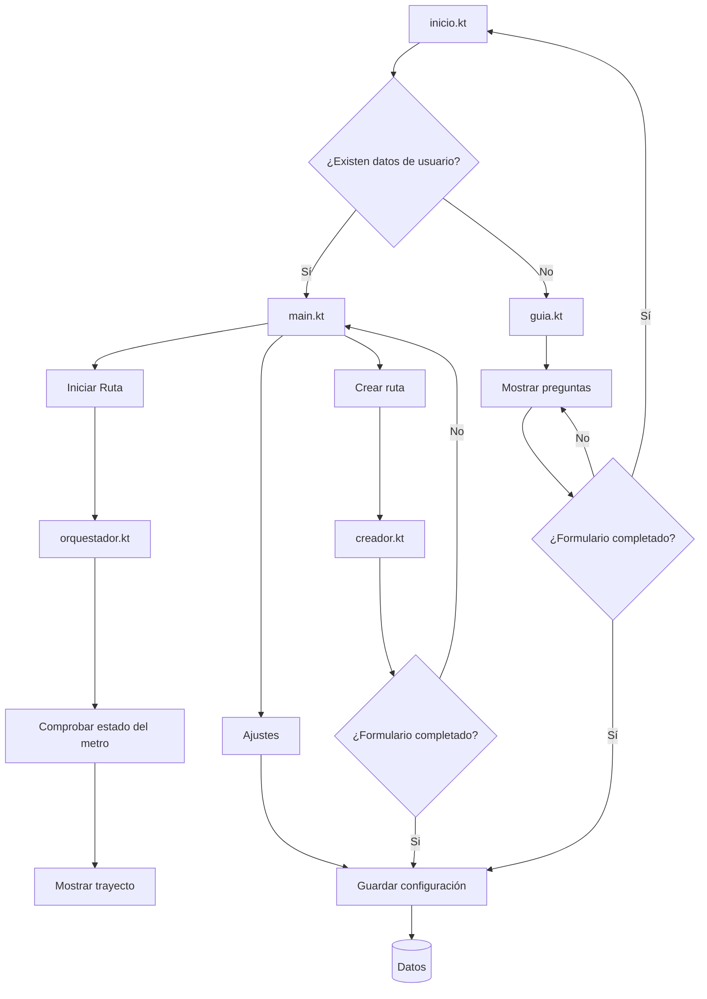
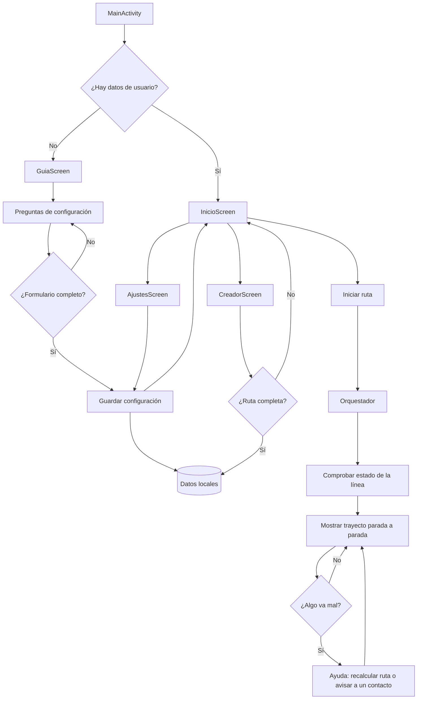

# RDM

## ¿Qué es?

`RDM` (*Rutas de Metro*) como nombre interno del proyecto.  
`Senda` como nombre comercial.

Senda es una aplicación destinada a personas con discapacidad intelectual que permite desplazarse por la red metropolitana de Madrid. Les guía parada a parada para que no se pierdan y lleguen a tiempo en la medida de lo posible, sin decidir por ellos: el usuario elige su viaje y la app le ayuda a hacerlo.

## ¿Qué se busca y qué se evita?

### Se busca

- Que la aplicación sea intuitiva y fácil de utilizar para cualquier tipo de persona.
- Que se pueda adaptar visualmente a usuarios específicos (tamaño del texto, contraste, pictogramas).
- Que funcione correctamente, minimizando errores y contemplando el control de excepciones.
- Que mantenga su funcionalidad y compatibilidad a largo plazo (`LTS`).
- Garantizar la privacidad y el control de los datos del usuario para que estos no salgan del dispositivo.

### Se evita

- Florituras, elementos innecesarios y distracciones.
- El uso de APIs (de pago) y cualquier coste repercutido al usuario final.

## Diseño: Apartados técnicos
``Diagrama intuitivo``

## Explicación breve de las actividades
### inicio.kt
Tal como su nombre indica es un punto de inicio, será una actividad vacía inicial, que actuará como puente.
### guia.kt
Dependiendo del tipo de usuario, y mediante un formulario, se determinará que ajustes son mejores para el usuario final. (Problemas de visión)
### main.kt
Mostrará un menu scrolleable, con todos los presets de viajes, ajustes, etc.
### creador.kt
Formulario creador de viajes.
### orquestador.kt
Se encarga de la parte importante del proyecto, revisar los datos y dibujar el trayecto parada por parada, con ayudas visuales.

## Caraterísticas
Android ?+ API ??
Guardar todas las rutas de transporte publico de Madrid en la base de datos para facilitar la orquestación?
Mapa de ...

## Diseño: Apartados técnicos (Propuesta diferente):
``Diagrama intuitivo``

La app usa una sola actividad (`MainActivity`) con Jetpack Compose. Cada parte de la app es una pantalla y la navegación entre ellas se gestiona con Navigation Compose.

## Pantallas

#### GuiaScreen
Solo aparece la primera vez. Mediante un formulario sencillo ajusta la app a la persona: problemas de visión, nivel de lectura (texto, lectura fácil o pictogramas) y contacto de apoyo. Si el usuario quiere, un familiar o tutor le puede ayudar a rellenarlo.

#### InicioScreen
Menú desplazable con las rutas guardadas, el acceso a crear una ruta nueva y los ajustes.

#### CreadorScreen
Formulario para crear una ruta: origen, destino y, si se quiere, hora de llegada.

#### AjustesScreen
Permite cambiar la configuración elegida en la guía.

#### Orquestador
Es la parte central del proyecto. Lee los datos de la ruta y muestra el trayecto parada a parada con ayudas visuales. También detecta problemas (por ejemplo, que el usuario se haya pasado de parada) y ofrece ayuda.

## Datos

- **Red de Metro (líneas, paradas y horarios):** se usarán los datos abiertos GTFS del Consorcio Regional de Transportes de Madrid, guardados dentro de la app para que funcione sin conexión.
- **Estado del servicio en tiempo real:** *(por confirmar)* falta comprobar si existe una fuente oficial, pública y gratuita.
- **Datos del usuario:** se guardan solo en el dispositivo (Room / DataStore).

## Requisitos

- Android 8.0 o superior (`minSdk 26`) *(por confirmar)*.
- Kotlin + Jetpack Compose.

``Fin de la propuesta diferente``

## Normas
- El primer commit deberá contener únicamente un proyecto estándar vacío.
- Se utilizará la convención Conventional Commits ``feat\refactor\fix\chore\...`` para nombrar los commits.
- Los mensajes deberán ser descriptivos, concisos y representar fielmente los cambios realizados.
- Se priorizarán varios commits pequeños y específicos frente a uno de gran tamaño.

## Permisos de la aplicación
``Storage`` ...
``Location`` ...
