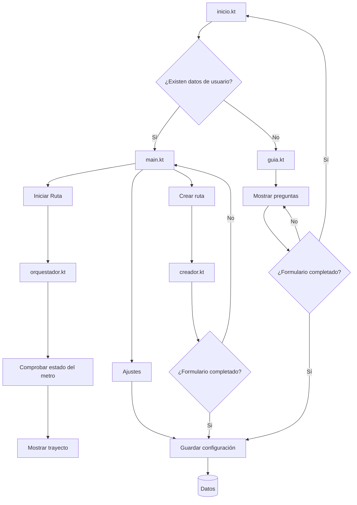

# RDM

## ¿Qué es?

`RDM` (*Rutas de Metro*) como nombre interno del proyecto.  
`Senda` como nombre comercial.

Aplicación destinada a personas con discapacidad intelectual que permite desplazarse por la red metropolitana de Madrid, ofreciendo asistencia durante el trayecto para evitar que se pierdan y ayudarles a llegar puntualmente en la medida de lo posible.

## ¿Qué se busca y qué se evita?

### Se busca

- Que la aplicación sea intuitiva y fácil de utilizar para cualquier tipo de persona.
- Que se pueda adaptar visualmente a usuarios específicos.
- Que funcione correctamente, minimizando errores y contemplando el control de excepciones.
- Que mantenga su funcionalidad y compatibilidad a largo plazo (`LTS`).
- Garantizar la privacidad y el control de los datos del usuario.

### Se evita

- Florituras, elementos innecesarios y distracciones.
- El uso de APIs y cualquier coste repercutido al usuario final.

## Diseño: Apartados técnicos
``Diagrama intuitivo``

## Normas
- El primer commit deberá contener únicamente un proyecto estándar vacío.
- Se utilizará la convención Conventional Commits ``feat\refactor\fix\chore\...`` para nombrar los commits.
- Los mensajes deberán ser descriptivos, concisos y representar fielmente los cambios realizados.
- Se priorizarán varios commits pequeños y específicos frente a uno de gran tamaño.

## Explicación breve de las actividades
### inicio.kt
Tal como su nombre indica es un punto de inicio, será una actividad vacía inicial, que actuará como puente.
### guia.kt
Dependiendo del tipo de usuario, y mediante un formulario, se determinará que ajustes son mejores para el usuario final. (Problemas de visión)
### main.kt
Mostrará un menu scrolleable, con todos los presets de viajes, ajustes, etc.
### creador.kt
Formulario creador de viajes.
### orquestador.kt
Se encarga de la parte importante del proyecto, revisar los datos y dibujar el trayecto parada por parada, con ayudas visuales.

## Caraterísticas
Android ?+ API ??
Mapa de ...

## Permisos de la aplicación
``Storage`` ...
``Location`` ...